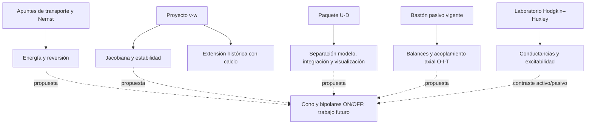

# Auditoría y consolidación de 2026-2

Auditoría del **6 de noviembre de 2026**. El origen es el directorio hermano
`Posgrado/2026-2/Neurofisiologia`; todas las rutas de origen de este informe son
relativas a él. El destino es `Posgrado/2027-1/Neurofisiologia`. El origen se
trata como solo lectura: no se ejecuta código allí ni se crean cachés en él.

## Estado inicial y frontera de la auditoría

- Origen sin repositorio Git, sin índice, diferencias Git ni remotos que consultar.
  Se registraron rutas, tamaños, modos y tiempos de modificación; ese registro
  detallado queda local, fuera de Git, por contener nombres privados.
- Destino limpio en `main`, igual a `origin/main` tras `git fetch origin`:
  `001eae1ad282cb183d520de0f2a9c10811fbd8f3`.
- GitHub confirma fusionados [PR #2](https://github.com/EduardoLinceGomez/Neurofisiologia/pull/2),
  [PR #4](https://github.com/EduardoLinceGomez/Neurofisiologia/pull/4) y
  [PR #5](https://github.com/EduardoLinceGomez/Neurofisiologia/pull/5).
  Sus commits `3682a0c35032877f38377a9207ab382f23af85d4`,
  `0f0e91725f37250d419707c125916f34401017eb` y el HEAD anterior son ancestros
  de `main`, comprobados con `git merge-base --is-ancestor`.
- Rama de consolidación creada desde ese `main`:
  `feat/consolidacion-neurofisiologia-2026-2`.
- Se leyeron `AGENTS.md`, README, ignore, decisión 0001, plan 02 y validación
  vigentes. No se cambia el contrato científico del bastón.
- No se abrieron documentos de `Bibliografia/`, sus subcarpetas ni documentos
  bibliográficos dispersos. Los PDF se clasifican **solo por nombre y tamaño**:
  no se extrajo texto, no se calcularon hashes ni se inspeccionaron páginas.
  `Semana1/` y `Semana3/` se trataron como colecciones bibliográficas equivalentes.

## Inventario y decisiones

Se encontraron **124 archivos, 494 459 230 bytes** (aproximadamente 471.6 MiB),
incluidos los productos de ejecución preexistentes. La carpeta privada contiene
48 archivos; fuera de ella hay 76. Se seleccionan **34 fuentes y recursos** y se
excluyen **90 archivos**. No se detectaron presentaciones PPT/PPTX, vídeos ni
animaciones independientes por extensión; los HTML y widgets son interactivos.
La ausencia de esas extensiones no prueba qué contienen los documentos excluidos.

El [inventario por archivo](inventario_2026-2.md) registra cada ruta externa a la
bibliografía privada, formato, tamaño, grupo y decisión. El
[manifiesto de procedencia](../materiales/2026-2/procedencia.json) identifica cada
fuente incorporada, destino, SHA-256 de origen y destino y transformación.
Las fichas siguientes añaden tema, propósito, dependencias y relaciones.

| Grupo y rutas de origen | Tema y propósito académico | Estado observado y dependencias | Comparación y decisión |
| --- | --- | --- | --- |
| H1: `hodgkin_huxley_laboratorio_interactivo.ipynb`, `requirements_hh_notebook.txt` | Excitabilidad: umbral, refractariedad y papel de Na/K/fuga; 14 celdas, 4 de código | Usa NumPy, Matplotlib, ipywidgets e **ipympl obligatorio** por `%matplotlib widget` y `fig.canvas` dentro de VBox. Fuentes y referencias conservadas | A/C/D: contenido nuevo y contraste pedagógico con respuesta pasiva. Incorporar como histórico; no reutilizar sus EDO en el bastón |
| H2: `generarHTML_HH.py`, `hh_umbral_interactivo.html` | Explorador de umbral HH en JavaScript generado desde Python | Generador usa biblioteca estándar; HTML carga Plotly 2.35.2 desde CDN. No es autónomo sin red | A/B/D: incorporar generador; excluir HTML generado. Texto regenerado idéntico al previo al normalizar CRLF/LF; bytes distintos |
| U0: `UD_basic+minimal_cb.ipynb` | Modelo Up–Down minimal y básico, reobase, controles | 19 celdas. Autoría explícita: Marco Arieli Herrera-Valdez, UNAM. Usa NumPy, Matplotlib, ipywidgets; no aparece licencia de redistribución | C/F: excluido completo, incluidas sus salidas. Su afinidad conceptual con PA y Proyecto no demuestra genealogía de código ni licencia |
| P1: `Proyecto/proyecto1.ipynb` | Proyecto de 17 apartados: v/w, soluciones, Jacobiana, nulclinas, puntos fijos, bifurcaciones, I-Clamp y extensión con calcio | 205 celdas, 104 de código. NumPy, SciPy, Matplotlib, SymPy, pandas. Integra con solve_ivp y RK4 local; conserva preguntas y explicaciones | A/C/D: incorporar como trabajo histórico; ejecución y corrección científica se evalúan por separado. Canales activos y ráfagas no pertenecen al modelo vigente |
| P2: `Proyecto/Jac1.jpg`…`Jac6.jpg`, `ej4-1.jpg`…`ej4-4.jpg` | Deducciones manuscritas de Jacobiana, nulclinas, traza/determinante | Diez imágenes revisadas visualmente; fórmulas manuscritas, sin datos personales visibles. P1 las enlaza en sus celdas 16 y 38 (índices desde cero) | A/D: conservar juntas y sin transformar, manteniendo los enlaces relativos. Revisión visual no equivale a validar cada fórmula |
| P3: `Proyecto/proyecto1.html` | Vista HTML del proyecto | Exportación aparente por nombre/contenido y tamaño; no es una segunda fuente de EDO | B/E: excluir producto exportado; no afirmar identidad exacta con el notebook |
| T1: `tarea2/tarea2.ipynb` | Apuntes de energía electroquímica, transporte, Nernst y ATP; ecuaciones 1–6 comentadas | Dos celdas Markdown, una vacía; **sin código**. No depende de las imágenes de la carpeta | A/C/D: incorporar como apuntes, no como simulación ni experimento ejecutable. Relación con la referencia de Herrera-Valdez propuesta a partir de tema y contexto de carpeta; versión exacta pendiente |
| T2: `tarea2/Fig*.png` (7 archivos) | Figuras asociadas a la actividad por ubicación | Procedencia no establecida; podrían ser recortes de artículos. No se necesitan para T1 | F: excluir sin copiar ni atribuirlas al usuario |
| A1: `PA/proyecto_neurofisiologia_ud_minimo/proyecto_neurofisiologia_ud_minimo/` (19 archivos seleccionados) | Paquete U–D básico: separa parámetros, estímulo, EDO, integración, análisis y visualización | Python ≥3.10; NumPy, Matplotlib, ipywidgets, ipympl. Demo de 3 celdas, 2 de código; una prueba. Código local sin aviso de autor externo observado | A/C/D: incorporar fuentes conservando estructura interna. Eliminar solo una envoltura de directorio repetida. Proyecto independiente, no dependencia del paquete vigente |
| A2: ZIP de PA y `data/cache/cache_umbral_ejemplo.npz` | Distribución empaquetada y resultados calculados | ZIP no extraído ni auditado; NPZ preexistente no tomado como evidencia válida | B/E: omitir ambos; ZIP posiblemente redundante, no demostrado idéntico. Regenerar caché desde las fuentes en `outputs/` |
| B1: `Bibliografia/` (48 archivos) | Colección privada de consulta | Solo metadatos. Incluye documentos, un Markdown y un notebook por extensión; contenido no examinado | F: excluir todo, independientemente de formato o aparente utilidad |
| B2: 17 PDF fuera de `Bibliografia/` | Apuntes, documentos de curso, tareas y referencias según nombres | Sin lectura; autoría, permisos, datos personales y contenido sin establecer | D/F: excluir por decisión pendiente. El mayor archivo es un libro de 260 417 592 bytes. No confundir extensión o ubicación con permiso de publicación |
| E1: 12 `.pyc` y un checkpoint | Productos/provisionales | No son fuentes canónicas; el checkpoint no se abrió | E: excluir. No se copiaron entornos virtuales ni cachés |

Las clases A–F son: nuevo, duplicado, complementario, histórico,
obsoleto/provisional y sensible/restringido. Pueden coexistir. Ninguno de los
34 candidatos es idéntico por SHA-256 a un archivo rastreado del `main` inicial.
Comparten conceptos con el bastón (balances, reversión, integración, figuras),
pero no son versiones intercambiables de su implementación. Los dos PDF llamados
`neurofisiologiaMatematica_2026-2.pdf` tienen el mismo tamaño: se registran como
**duplicado posible**, sin leerlos ni afirmar igualdad de contenido. Lo mismo
aplica a títulos/tamaños repetidos dentro y fuera de la bibliografía.

## Dependencias entre materiales

- H1 contiene sus propias tasas HH e integrador; el TXT declara su entorno.
  H2 contiene otra implementación en JavaScript; la similitud temática no prueba
  equivalencia numérica con H1. Su salida es `hh_umbral_interactivo.html`.
- P1 importa bibliotecas externas, pero no importa H1, U0 ni PA. Sus imágenes
  manuscritas son dependencias de lectura, no del cálculo.
- T1 desarrolla explicaciones originales del ejercicio; no carga los PDF ni PNG
  adyacentes. No se trasladaron enunciados PDF ni artículos completos.
- PA: `configuracion.py` → rejilla; `estimulo.py` → pulsos;
  `modelos/sistema_ud.py` → EDO y Jacobiana; integrador → trayectorias;
  `cache/constructor_umbral.py` → integrador + almacenamiento NPZ;
  `analisis.py` → medidas; `visualizacion.py` → caché + análisis + modelo.
  El script genera el NPZ y la demo lo carga: **la demo sola no lo construye**.
  `tests/test_minimo.py` comprueba un reposo y las formas de la caché.
- El paquete actual `src/neurofisiologia/` y sus dos notebooks siguen separados;
  ningún import nuevo une el archivo histórico al bastón.

## Integración, autoría y límites

Se conservan nombres, código, textos y atribuciones existentes. Los materiales
seleccionados se consideran trabajos locales de estudio por su contenido y el
encargo del propietario; no se les atribuye una autoría nueva ni se añade una
licencia inventada. El notebook con firma de tercero se excluye expresamente.
No se encontraron credenciales ni rutas personales en las fuentes seleccionadas;
las imágenes se revisaron también por metadatos. La revisión es acotada a esas
fuentes, no una certificación de los archivos privados no abiertos.

Los notebooks se serializan sin salidas ni contadores; su secuencia de tipos de
celda y **cada campo `source` se conserva**. No se modernizan algoritmos ni se
corrigen silenciosamente explicaciones. El original íntegro, con sus salidas,
permanece en 2026-2; no se crea otra copia de ese original en Git. Los archivos
restantes se copian byte a byte. El README original de PA contiene caracteres de
control en algunas fórmulas; se conserva así y se advierte al lector en el índice.

El alcance pasivo de `AGENTS.md` sigue rigiendo el desarrollo actual. Los modelos
activos incorporados son exclusivamente **antecedentes históricos** autorizados
por este encargo de consolidación. No se trasplantan parámetros, mecanismos,
calcio ni spikes al bastón. Las trazas históricas son simulaciones, no mediciones.

## Referencias públicas y trazabilidad científica

- H1 cita Hodgkin y Huxley (1952),
  [artículo original, DOI 10.1113/jphysiol.1952.sp004764](https://physoc.onlinelibrary.wiley.com/doi/10.1113/jphysiol.1952.sp004764).
  No se ha contrastado cada constante del notebook con una figura/tabla ni se
  ha calibrado esta implementación. H1 expresa C en µF/cm², g en mS/cm²,
  I en µA/cm² y V/t en mV/ms: son densidades, diferentes de pF/nS/pA del bastón.
- Para T1 se ofrece como localizador público
  [Herrera-Valdez, transporte transmembranal, versión 2 (2018)](https://f1000research.com/articles/7-1468/v2).
  Es una conexión bibliográfica propuesta; no se verificó qué versión usó el
  ejercicio ni se consultó su PDF local. No se extraen datos experimentales.
- P1 y PA son modelos matemáticos ilustrativos sin especie/figura experimental
  establecida en esta auditoría. PA declara corrientes normalizadas por C; sus
  J no se pueden interpretar directamente como pA del bastón. La procedencia
  exacta de sus parámetros y ecuaciones de notas requiere revisión posterior.
- Se conserva intacta la referencia experimental del bastón en
  [referencias y parámetros](referencias_y_parametros.md): no se añaden datos ni
  se fusionan calibraciones de especies distintas.

## Puente hacia Cono → Bipolar ON / OFF

La prioridad futura comunicada por el usuario es reproducir respuestas graduadas
ON/OFF. **No se implementa en esta entrega.** El mapa distingue relaciones
observadas (línea continua) y propuestas de estudio (línea discontinua).

| Objetivo futuro | Apoyo encontrado | Lo que sigue faltando |
| --- | --- | --- |
| Potenciales graduados y regiones recepción/soma/salida | Bastón 01/02 y sus balances; T1 para signos/reversión | Arquitectura, fisiología y parámetros específicos de cono y bipolares |
| Estabilidad y respuesta a estímulos | P1: Jacobiana, puntos fijos y barridos; PA: pulsos y análisis | Validar estabilidad del futuro modelo graduado; las ráfagas históricas no son objetivo ON/OFF |
| Comparar discretizaciones | Laboratorio vigente de uno/dos/tres nodos | Teoría de cable, geometría cilíndrica y convergencia espacial: no se identificó una implementación en las fuentes auditadas |
| Sinapsis, conductancias excitatorias/inhibitorias y GABA | T1 y balances ofrecen preparación conceptual; conexión propuesta | Receptores, signos, cinética, datos y fuentes específicos. No se encontró una implementación intercelular reutilizable comprobada |
| Decenas de células y ganglionares | PA vectoriza **trayectorias independientes**, una idea organizativa útil | Eso no es una red acoplada; faltan conectividad, sinapsis, validación y objetivos ganglionares |

La reutilización propuesta se limita a hábitos: separar parámetros/estímulos/EDO,
comprobar unidades, estudiar estabilidad y distinguir cálculo de visualización.
Reutilizar código exigiría pruebas y justificación posteriores. En PA, la búsqueda
de reposo puede devolver el mínimo residual de una malla si no encuentra cambio
de signo; no basta para certificar una raíz. Su caché desplaza trazas al cambiar
el inicio del pulso, sin resimular. Estas limitaciones se conservan y documentan.

## Validación

La evidencia de ejecución y preservación se registra al finalizar en
[validación de la consolidación](validacion_consolidacion_2026-2.md).
La existencia de un archivo, una figura almacenada o una ejecución sin excepción
no certifica su corrección matemática ni su fidelidad fisiológica. Quedan
pendientes revisión científica de los históricos, permisos de los excluidos y
evaluación manual de las interfaces en el frontend de estudio.
